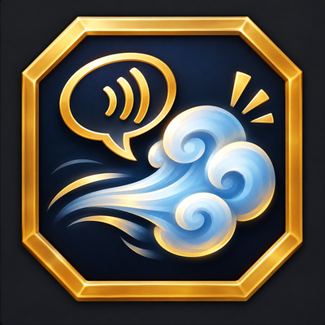

# Spoken Wind

WoW Forever addon. **Spoken** gave the NPCs a voice. **Spoken Wind** gives one to the players.

For years, heroes of Azeroth typed `/fart` and the world stayed silent. A text line. Nothing else. No more.
Today, every player is finally heard.

**Someone types /fart near you. You hear it.**

- Every player gets a voice: their own race and body. 9 races x 2 bodies x 74 sounds, + 5 Artifact sounds = 1337.
- 14 original fart sounds, made from scratch (no samples): a rare Classic tier in every voice (1 in 200),
  and the sounds for players with no race data
- Rarity: Poor to Legendary (1 in 500), Artifact (1 in 5000)
- Same fart for everyone: every Spoken Wind user near you hears the same sound, nearly always (also when the
  farter has no addon)
- Never the same one twice in a row from one person
- One sound per person at a time: a person's next fart waits until their sound ends (min 1 s), so spam does
  not stack (two people farting = two sounds)
- Your own /fart plays too
- 34 achievements (+ a few secret ones), each with a toast; 15 of them unlock a reward emote
- Collection: every fart sound you heard, one page per voice, click one to play it again
- Board: top 10 Most heard + Top listener of the players you met with the addon (party and guild)
- Heard count: how many Spoken Wind users heard your fart
- Fart button: one click = one /fart
- Fart log: who, when, which sound (kept on your PC only)
- **Random farts, on by default**: one `/fart` about once per hour (45-75 min), one when you leave a sleeping bag,
  and a rare fart attack on waking (one emote line, a few farts, then `/sigh`).
  Off: `/wind random off`, or **Options → AddOns → Spoken Wind → Random farts**.
- No Blizzard frames touched. One post-hook on the game's emote call.

Not part of the Spoken addons. Just a joke.

## What it sends

- **Hidden addon messages** (prefix `SpWind`, never shown in chat) to your party or raid, your guild, and SAY in
  an instance:
  - one per own `/fart` (so everyone hears the same sound),
  - one "heard it" reply per fart you hear that came with a message,
  - board numbers: on each own `/fart` and one every 5-6 min (party and guild only, none in combat).
    `/wind board off` = others drop you from their boards.
  - pair test (`/wind pair`): whispers to your partner only.
- **Fart button** on a player target: one hidden addon whisper asks if they have the addon. No answer = a whisper
  icon. Click it = one whisper line about Spoken Wind. Two clicks, always yours.
- **Chat lines** only when you use a reward emote, click the whisper icon, a random fart (`/fart`), a fart attack
  (one emote line + `/sigh`), or a very rare surprise of your own.
- No account id. Nothing links your characters.

## Commands

| Command | Does |
|---|---|
| `/wind` | status |
| `/wind on` / `off` | on or off |
| `/wind random on` / `off` / `status` | random farts (on by default) |
| `/wind ach [classic` / `social` / `collection` / `board]` | the achievements window |
| `/wind ch master` / `sfx` / `dialog` | which volume slider |
| `/wind self on` / `off` | your own /fart |
| `/wind cd 0-30` | min seconds between sounds per person (default 1) |
| `/wind wait 0-300` | ms to wait for a group or guild fart message (default 150) |
| `/wind board off` / `on` / `status` | off = others drop you from their boards |
| `/wind pair [name]` / `pair off` | pair test: you and one other player check that you hear the same farts |
| `/wind reset` | defaults |

`/spokenwind` works too. **Options → AddOns → Spoken Wind** has the same settings, the Fart log and the Changelog.

Made for the English client. Other languages: best guess. If one is silent, open an issue or a PR.

## Add an emote

`Spoken_Wind/Emotes.lua` has one row per emote token. Each row points to a sound folder `Media/<folder>/`.
A new emote = one row + its folder. No code change.

## Dev

    python -I tools/synth.py      rebuild the 14 original sounds (new bytes each run: ogg serial is random)
    python -I tools/analyze.py    number checks on the decoded oggs + spectrograms
    python -I tools/preview.py    rebuild preview/index.html (hear the 14 original sounds in a browser)
    python -I tools/lua.py all    compile + Lua tests + the sound length table + the board sim (tools/sim)
    python -I tools/mutate.py     break the code on purpose; the tests must catch all
    python -I tools/stage.py      stage/Spoken_Wind + stage/MANIFEST.md5
    python tools/icons.py [dir]   cut the icon sheets into Media/ach/*.tga + ring.tga (Pillow, numpy, scipy)

`tools/lua.py` needs a LuaJIT `lua51.dll`. Default: the one OBS Studio installs.
Set `LUA51_DLL_DIR` to use another folder.

The log is in `SpokenWindDB.log` (BOOT, PLAY, SKIP, ACH, REWARD, DEX, ERR, SUM lines).
Sync lines are in `SpokenWindDB.sync`.

## License

MIT. See `LICENSE`.
